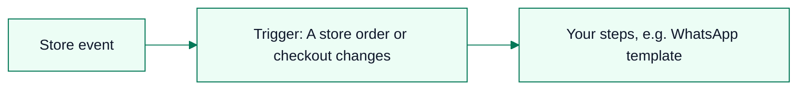

Connect your own store and Marro hears about its orders. A customer with a phone number becomes a lead (source **Shopify** or **WooCommerce**) or is added to the lead they already are. Nothing is sent to the customer unless an automation you made sends it.

## Connect Shopify

<Steps>
  <Step title="Make an app in Shopify">Open **Settings → Apps and sales channels → Develop apps** and create an app with read access to orders and checkouts.</Step>
  <Step title="Connect in Marro">Open **Settings → Integrations → Shopify**, enter your store address (`your-store.myshopify.com`) and the app's API secret key, then press **Connect**.</Step>
  <Step title="Add webhooks">In the app, add a JSON webhook for each of `orders/create`, `orders/paid`, `fulfillments/create` and `checkouts/update`, using the URL shown in Marro.</Step>
</Steps>

## Connect WooCommerce

<Steps>
  <Step title="Connect in Marro">Open **Settings → Integrations → WooCommerce**, enter your store address (https) and press **Connect**. Marro shows a webhook URL and a secret.</Step>
  <Step title="Add webhooks">In WordPress, open **WooCommerce → Settings → Advanced → Webhooks** and add two webhooks, topics **Order created** and **Order updated**, with that URL and secret.</Step>
</Steps>

## What each event does

Each step is written once as a note on the lead's timeline.

| Event | Source | Note |
| --- | --- | --- |
| Order placed | Shopify, WooCommerce | Order note |
| Order paid | Shopify paid, WooCommerce Processing | Payment note |
| Order shipped | Shopify fulfilment, WooCommerce Completed | Tracking link where Shopify gives one |
| Checkout left unfinished | Shopify only | Link back to the checkout |

A customer with no phone number is added to an existing lead when the email matches; otherwise no lead is made.

## Start an automation

In **Automations**, choose that trigger, optionally limited to some events, then add the steps you want.
