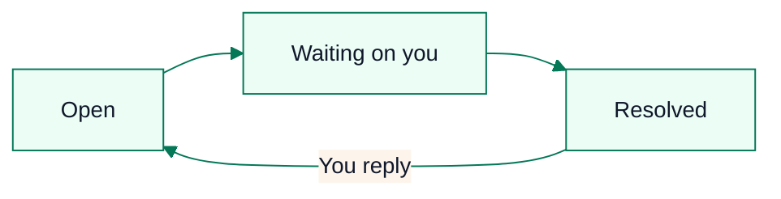

Support pages and requests use no AI credits, so they work even when credits have run out.

## Open Help and support

<CardGroup cols={2}>
  <Card title="Web" icon="browser">**Help and support** in the sidebar above the account menu, or the command menu (`⌘K` on Mac, `Ctrl+K` on Windows).</Card>
  <Card title="Phone browser" icon="device-mobile">The lifebuoy **Help** button in the header, or **Help and support** in the Menu drawer.</Card>
  <Card title="Mobile app" icon="mobile" href="/guides/mobile-app">The **Help and support** tile in **Menu**, or **Account > Help**. Arrives with the next app build.</Card>
</CardGroup>

## Find an answer

The page has **Talk to us** (email, WhatsApp and support hours) beside **Send a request**, then **Common questions** on getting started, leads, Inbox, calling, the assistant, billing, team and your data. Each links to its guide. You can also ask the [assistant](/guides/assistant).

## Send a request

Check the common questions first. Billing, payments, data loss, account security and data concerns go straight to Marro's team.

1. Under **Send a request**, choose a category.
2. Describe the problem briefly.
3. Choose **Send request**. You get a request number and a link to follow it.

| Category |
| --- |
| **Something isn't working** |
| **Help using Marro** |
| **Billing and payments** |
| **Sign-in, account or security** |
| **Something else** |

Don't include customer data: no phone numbers, emails or passwords. Attachments aren't supported. Only your message is shared, with your organization, account, category, page, subscription name and app version.

<Card title="Let Marro take it" icon="message-circle">
  Under "Prefer to talk it through?", this opens the assistant with the start of a message.

  *"Our WhatsApp number stopped receiving messages."*

  Marro asks what happened and shows a summary. Nothing reaches the team until you approve it, even in Auto mode.
</Card>

## Follow a request

**Your requests** (administrators see **Organization requests**) appears below the common questions once you have one.

Open a request to read the conversation and reply. Replies from the team show as an unread notification and in the chat you raised it from. They are not emailed.

When you raise a request and when it is resolved, you get a short WhatsApp notice with only the request number and category. It goes out once Meta has approved Marro's notice templates.

In the mobile app you can raise a request, see its status, read the conversation and reply. The app shows what will be sent before you confirm.

## Contact Marro

| Way | Details |
| --- | --- |
| Email | [hello@marro.si](mailto:hello@marro.si) |
| WhatsApp | **+91 79813 33635** |
| Hours | **Monday to Saturday, 10 am to 10 pm India time** |

Can't sign in? Use the [public support page](https://app.marro.si/legal/support).
