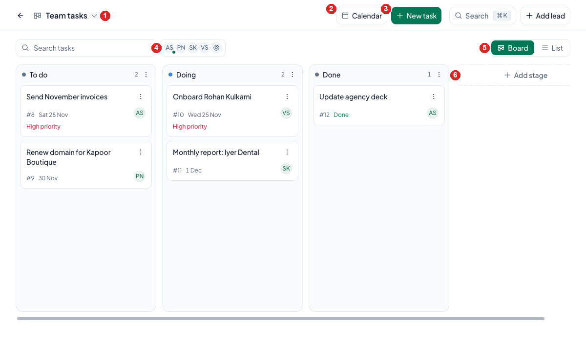
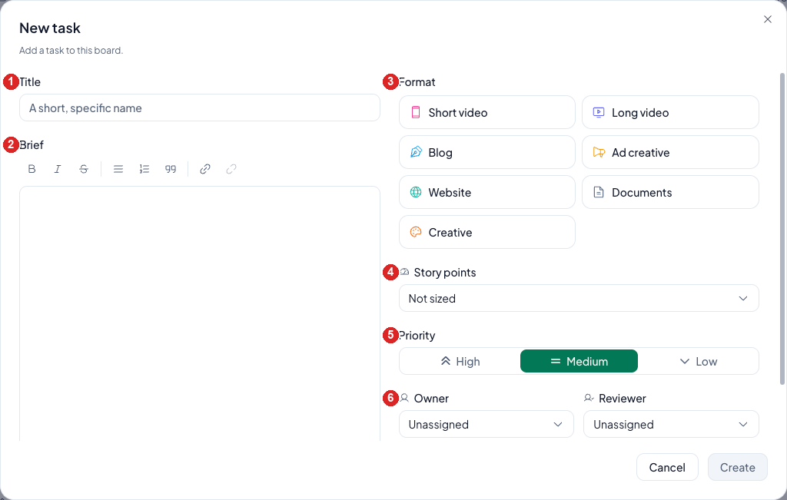
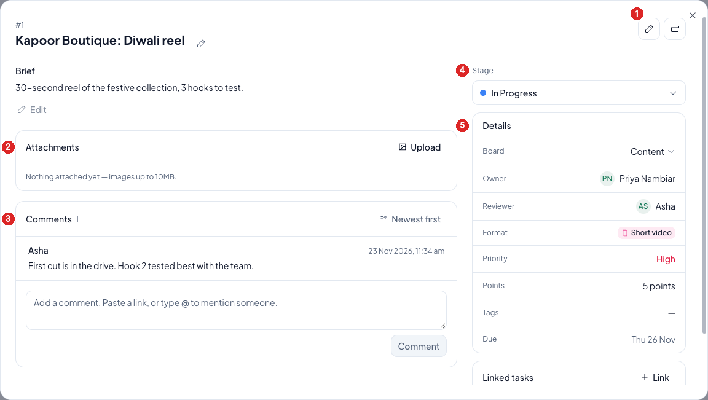
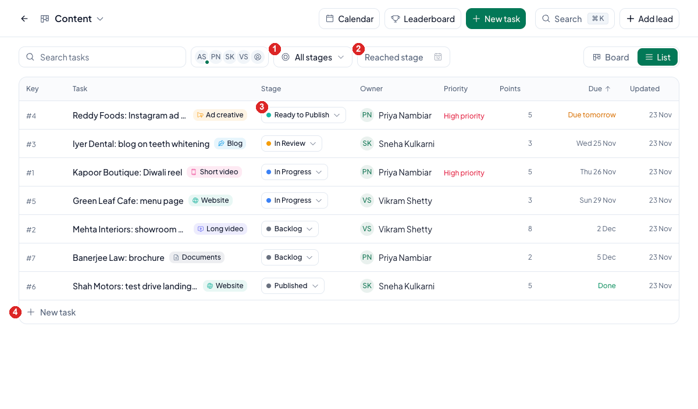
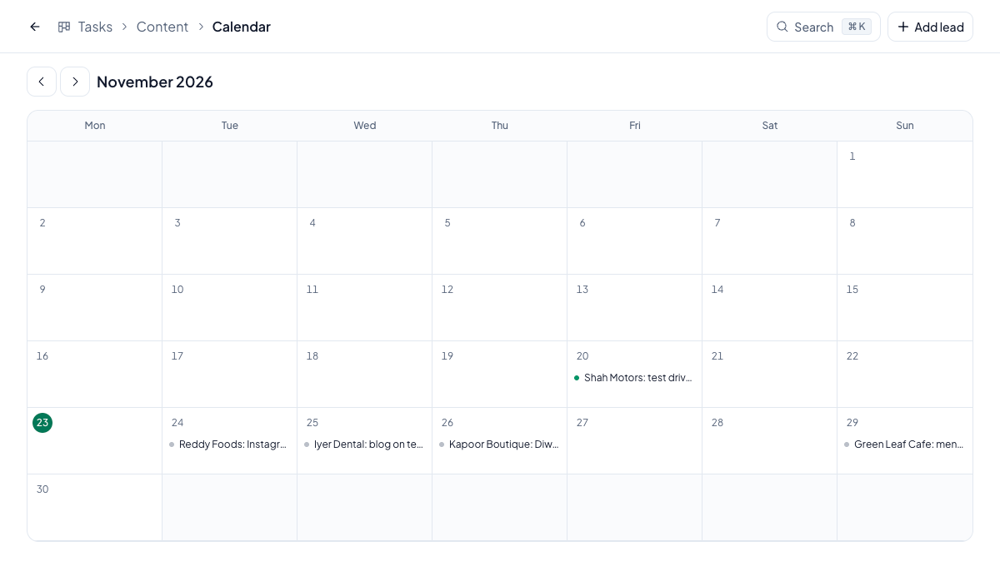
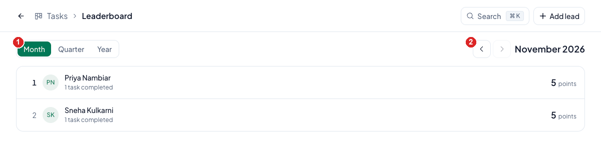
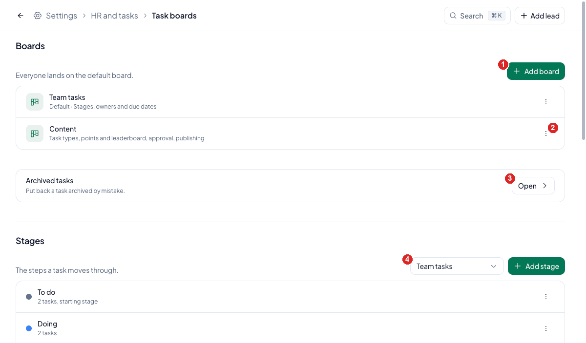
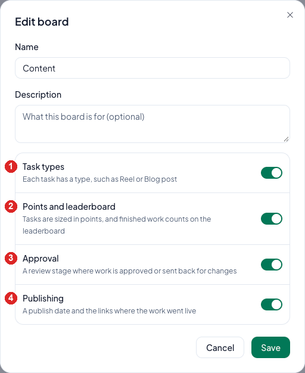

**Tasks** are your team's work on boards, one card per piece of work, moving left to right through stages. Use them for anything that is not a lead: invoices to send, a client's report, a video to edit. Open **Tasks**.

<Note>
Tasks are not follow-ups. A follow-up is a call or to-do booked on a lead, and lives in **Follow-ups** and on the lead page.
</Note>

## A board

<Frame>
  
</Frame>

1. The board's name. Click it to switch boards.
2. **Calendar**: this board's tasks by date.
3. **New task** adds a task to this board.
4. Show only one person's tasks. The last icon shows tasks with no owner.
5. **Board** or **List**.
6. **Add stage** adds a column to this board.

Boards with points also have **Leaderboard** here.

Drag a card to move it to another stage. Each card shows its ticket number (**#8**), its due date, its priority and the owner's initials.

Every organization starts with two boards: **Team tasks**, the default, with **To do**, **Doing** and **Done**; and **Content**, for work that is reviewed and published.

## Add a task

<Frame>
  
</Frame>

1. **Title**: short and specific.
2. **Brief**: what the task needs, who it is for, links to follow.
3. **Format**: the kind of work, such as **Short video** or **Blog**.
4. **Story points**: how big it is.
5. **Priority**: **High**, **Medium** or **Low**.
6. **Owner** does the work. **Reviewer** approves it.

The due date is below. Format, points and reviewer appear only on boards that use them (see [Board settings](#board-settings)).

## Open a task

Click a card. Its ticket number stays the same, so you can share **#1** or its address with your team.

<Frame>
  
</Frame>

1. **Edit** and **Archive**.
2. **Attachments**: images up to 10 MB.
3. **Comments**. Type **@** to mention someone; they are told.
4. **Stage**: move the task on from here.
5. **Details**: board, owner, reviewer, format, priority, points, tags and due date. Move the task to another board from here; change the rest with **Edit** (1).

Only people who can approve tasks set story points.

<Warning>
On a board with **Approval** on, only people who can approve tasks move work out of a review stage. Moving it back counts as a revision.
</Warning>

## The list

<Frame>
  
</Frame>

1. Show only some stages.
2. **Reached stage**: tasks that moved into their stage in a period, such as last month.
3. Change a task's stage from its row.
4. **New task**, at the bottom of the list.

Click a column heading to sort by it.

## Calendar

Click **Calendar** at the top of a board. Each task is on its publish date, or its due date when it has none. A green dot is done, a red dot is overdue.

<Frame>
  
</Frame>

On a phone, the days show a dot and the month's tasks are listed under the calendar.

## Leaderboard

On boards with **Points and leaderboard** on, **Leaderboard** shows the story points each person completed. A task counts once it is finished, or ready to publish.

<Frame>
  
</Frame>

1. **Month**, **Quarter** or **Year**.
2. Go back to an earlier period.

<Note>
A task without story points counts as completed but adds no points. Size tasks before they are finished.
</Note>

## Board settings

Admins manage boards in **Settings → HR and tasks → Task boards**.

<Frame>
  
</Frame>

1. **Add board**. You can have up to 30.
2. A board's menu: **Edit**, **Make default** and **Archive**.
3. **Archived tasks**: put back a task archived by mistake.
4. Choose a board to change its stages: add, rename, recolour or reorder them. Each board has one starting stage.

Below the stages are **Types** and **Tags**, shared by every board.

<Frame>
  
</Frame>

Switch on only what a board needs:

1. **Task types**: each task has a type.
2. **Points and leaderboard**: story points, and the leaderboard.
3. **Approval**: a review stage where work is approved or sent back.
4. **Publishing**: a publish date, and the links where the work went live. A link is required to finish the task.

<Warning>
The default board cannot be archived, and no board can be archived while it still has open tasks. Move or finish them first.
</Warning>

## Ask Marro

<Card title="Try asking" icon="message-circle">
  *"What tasks are due this week?"*

  *"Add a task on the Content board: Diwali reel for Kapoor Boutique, due Friday, for Priya."*

  *"Who has the most points this month?"*
</Card>
