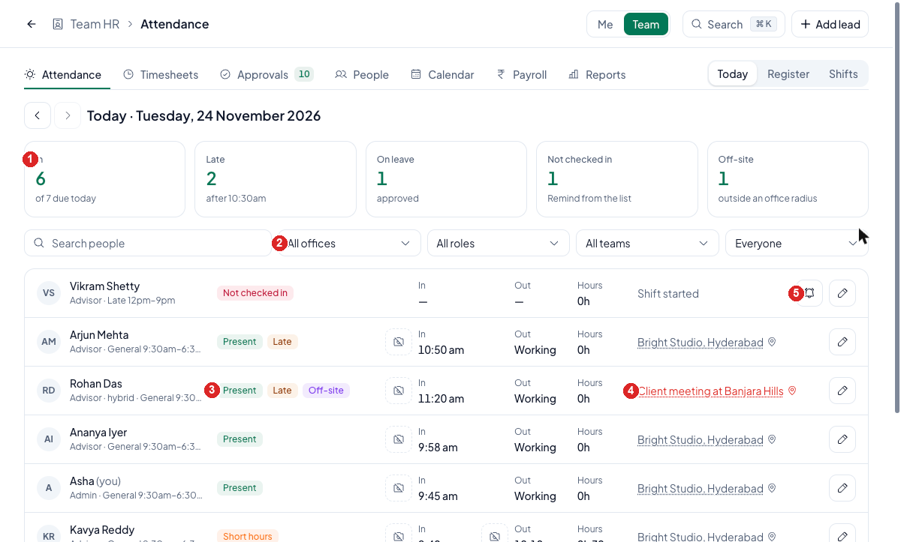
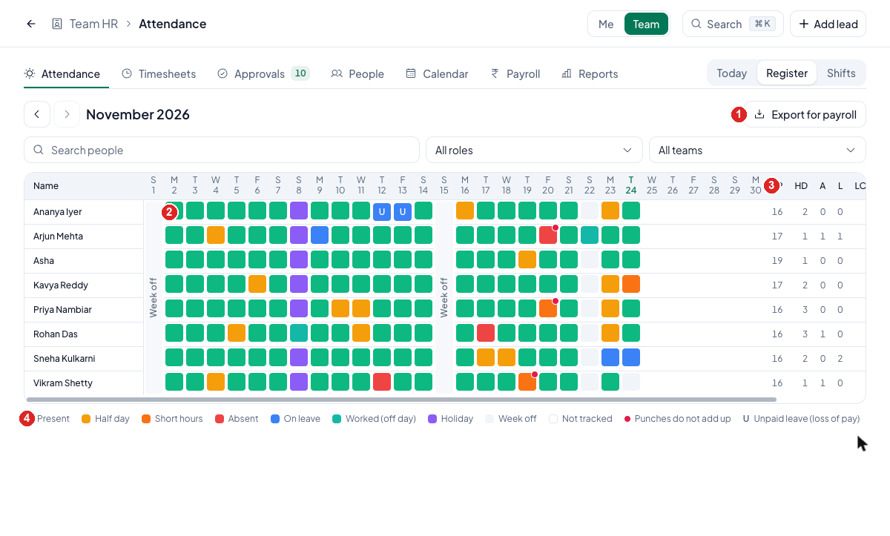
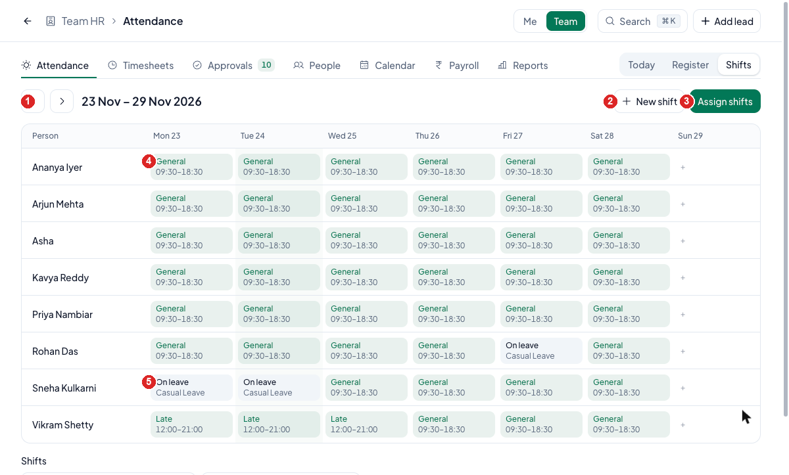
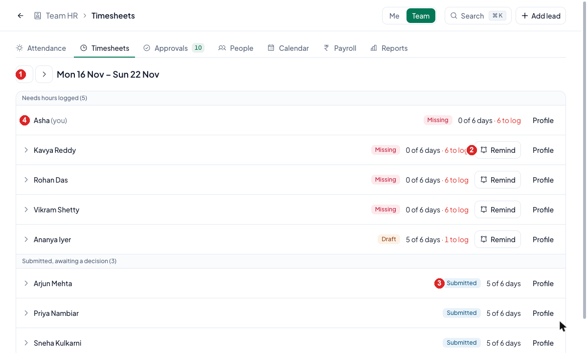
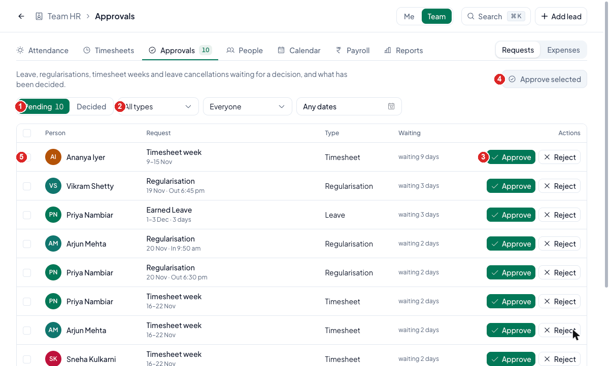
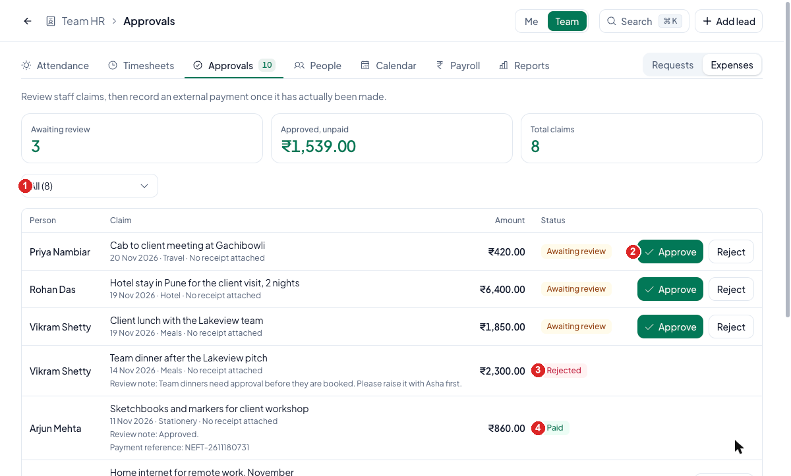
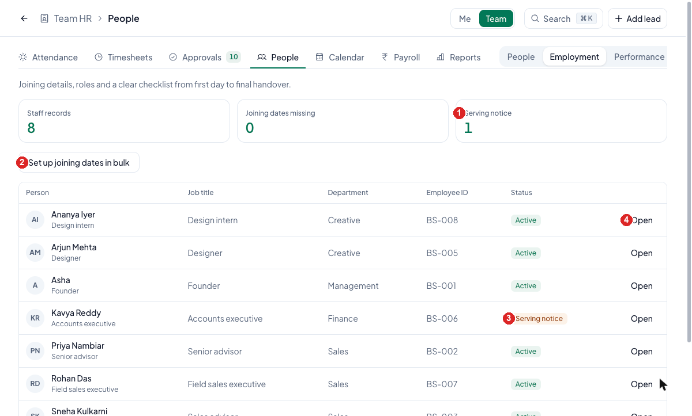
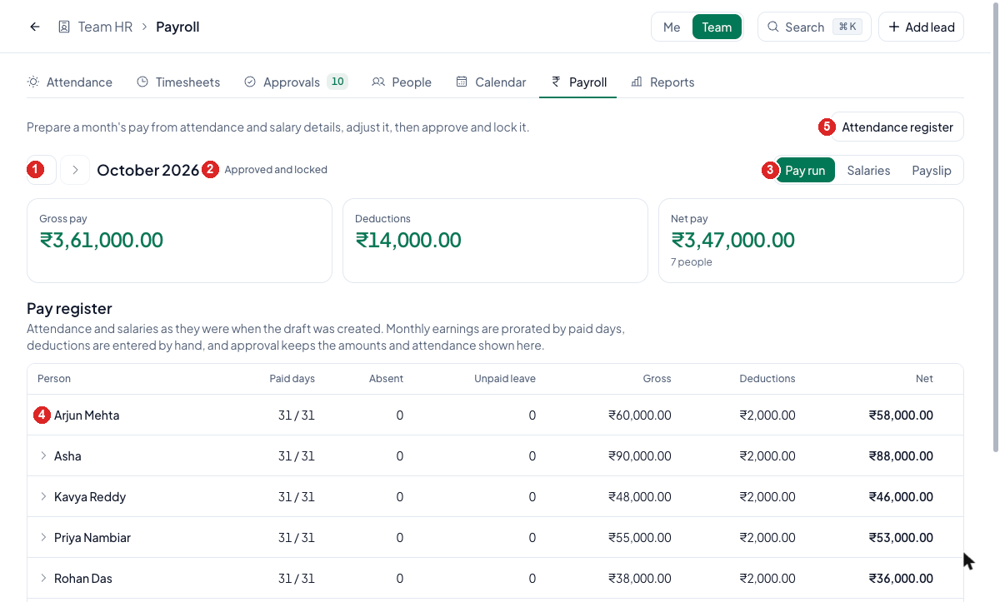

Open **HR → Team**. Approvers see what waits for them. People who may see everyone's HR records see attendance, people and reports. Payroll is for roles that run it.

## Attendance

<Frame>
  
</Frame>

1. Who is in, late, on leave, not checked in, and working away from the office. Select a number to list just those people.
2. Filter by office, role or team.
3. Each person's day: **Present**, **Late**, **Off-site** or **On leave**.
4. Where they checked in. Select it to see the map.
5. **Remind** someone who has not checked in. The pencil corrects a day.

<Frame>
  
</Frame>

1. **Export for payroll** downloads the month.
2. One square per day, coloured by how the day counts.
3. Totals: present, half days, absences, leave, and loss of pay.
4. What each colour means. A red dot means the check-ins and outs do not add up.

<Frame>
  
</Frame>

1. Move between weeks.
2. **New shift**: a name, start, end and unpaid break. An end before the start ends the next day.
3. **Assign shifts**: one person, one shift, a run of dates and the weekdays.
4. Select a day to change its shift or clear it.
5. Approved leave shows on the day.

## Timesheets

<Frame>
  
</Frame>

1. The week. Last week is shown first.
2. **Remind** someone who has not logged their hours.
3. **Submitted** weeks wait in **Approvals**.
4. Open a row to see the days.

## Approvals

<Frame>
  
</Frame>

1. **Pending** and **Decided**.
2. Filter by type, person or dates.
3. **Approve** or **Reject**, with a note.
4. **Approve selected** decides several at once.
5. Tick the ones to approve together.

<Frame>
  
</Frame>

1. Show claims to review, to pay, paid, rejected or all.
2. **Approve** or **Reject** with a note.
3. A rejected claim keeps the reason.
4. **Mark paid** records the payment reference once you have paid it.

## People

<Frame>
  
</Frame>

1. Staff records, joining dates missing and anyone serving notice.
2. **Set up joining dates in bulk**.
3. **Active** or **Serving notice**.
4. **Open** a person for their joining details, onboarding and handover checklist, leave, requests and timesheets.

**People** lists everyone with their office and how they work (office, remote, hybrid). **Performance** keeps goals and reviews.

## Payroll

<Frame>
  
</Frame>

1. The month.
2. Its state: no run yet, draft, or approved and locked.
3. **Pay run**, **Salaries** (each person's pay details) and **Payslip** (its design).
4. Open a person for their paid days and amounts. **Adjust** adds a one-time earning or deduction to a draft.
5. **Attendance register** checks the days behind the pay.

Payroll readiness lists anyone without salary details or a joining date before you start. **Create draft register** works out the month from attendance and salaries. **Review and approve** locks it and publishes payslips to **My HR → Pay**. See [Payslip design](/guides/payslip-customization).

## Calendar and reports

- **Calendar**: who is away and the holidays, by month or week.
- **Reports**: the attendance muster, leave and timesheets for payroll and compliance, as CSV. **Activity** lists every request, decision and change in HR.

## Ask Marro

<Card title="Try asking" icon="message-circle">
  *"Who is on leave this week?"*

  *"Approve Priya's earned leave for 1 to 3 December"*

  *"What is waiting for my approval?"*

  Marro asks before approving or rejecting anything.
</Card>
