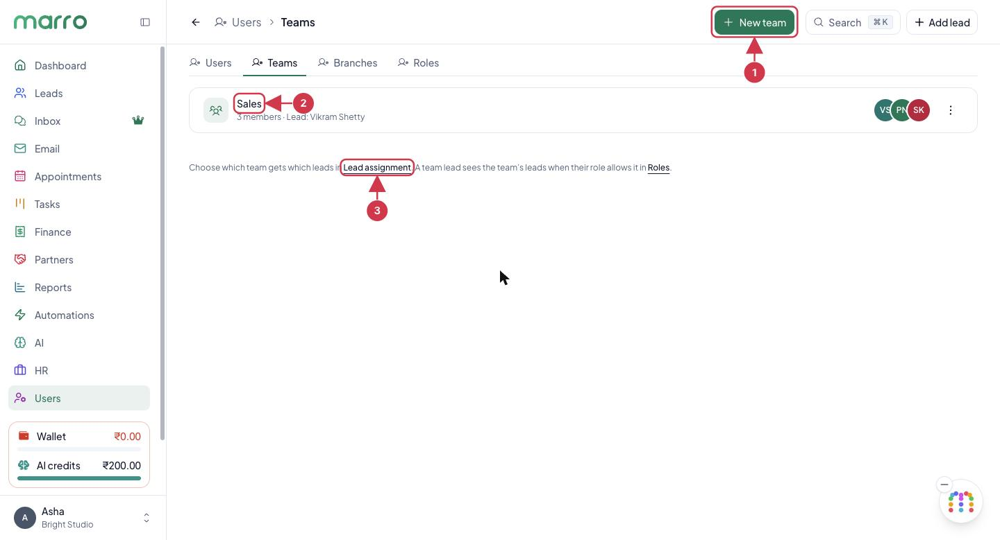

import { Flow } from "/snippets/flow.jsx";

Open **Users → Teams**. Teams group people so leads can be shared out and reported on together.

## Make a team

<Frame>
  
</Frame>

<Steps>
  <Step title="New team">Choose **New team** and name it.</Step>
  <Step title="Add members">Open the team to see and change its members.</Step>
  <Step title="Choose the lead">Pick the team lead on the same page.</Step>
</Steps>

## Share leads between teams

<Flow steps={["New lead", "Lead assignment rule", "Team", "Member"]} />

**Lead assignment** is where you choose which team gets which leads. See [Lead assignment and rotation](/guides/lead-assignment).

## Ask Marro

<Card title="Try asking" icon="message-circle">
  *"Who is in the Pune team?"*

  Marro lists the members; changes need your approval.
</Card>
