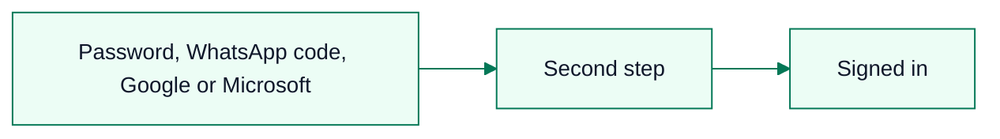
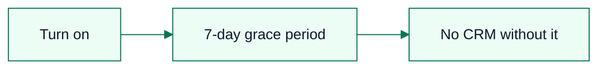

Open **Sign-in security** in your account menu (or go to `/account/security`). These settings protect your login across all your organizations.

## Set up an authenticator

1. Verify your password or an existing sign-in method. Verification lasts five minutes.
2. Choose **Set up authenticator**. Scan the QR code in your app, or enter the text secret.
3. Enter the six-digit code. Two-step sign-in turns on only after this code is checked.
4. Generate backup codes and keep them away from your sign-in device.

No password because you use Google or Microsoft? Use **Forgot password** first. If you sign in through your company, choose **Continue with** your company's connection to verify (see [Company sign-in](/guides/company-sign-in#confirm-its-you-with-your-company)).

Never paste the setup secret, a sign-in code or a backup code into Ask Marro or WhatsApp.

## Use a passkey

1. Add a passkey and name it, such as **My phone**.
2. Your browser asks your device to verify you by fingerprint, face or PIN.

Marro keeps only the public credential. On the web a passkey is a second step, not a sign-in on its own. It works only on the address where it was registered, so on an organization's custom domain use an authenticator or backup code. The Marro app can also sign you in with just a passkey.

## Sign in

On the web, enter your **Authenticator code**, or open **Try other methods** for a passkey or backup code. Choose **Sign out** to leave.

| Option | What it does |
| --- | --- |
| **Trust this device for 30 days** | Skips the second step on that private browser. You still need your first step |
| Platform administrators | Must verify a second step every time |
| After company sign-in | Marro skips its own code if your provider already asked for a second factor |

The challenge expires after five minutes, and five wrong tries end it.

## Backup codes and lost devices

| | |
| --- | --- |
| Codes in a set | Ten, shown once. Each works once |
| Regenerate | Invalidates every earlier code |
| Lost everything | Use a backup code, or ask an organization administrator to reset you from **Settings → Sign-in security** |

A reset removes your factors, signs out every browser and phone, revokes trusted devices and emails you. Organization administrators can't reset a platform administrator.

## Review and remove access

Your security page lists passkeys (last used) and trusted browsers (expiry).

- **Revoke** asks that browser for a second step next time.
- **Sign out other devices** ends all other web and mobile sessions and trusted devices.
- Changing your password signs out sessions and invalidates trusted devices.
- Removing your last authenticator or passkey turns two-step off and invalidates backup codes.

Security changes are audited and emailed to you.

## Require it for an organization

An administrator turns on **Require two-step sign-in** under **Settings → Sign-in security**, and sees who has set it up (never their methods or secrets).

Turning it off doesn't remove anyone's factors. Platform administrators have no grace period for the console.

## What it protects

It protects you when someone has your password or a WhatsApp code. Sign-in codes go to WhatsApp, or email if you ask. It doesn't lock an open device, protect a compromised browser, challenge every WhatsApp assistant message or change API-key access. Ask Marro can point you to the security page but can't see or change your factors.

## In the Marro app

After your password or WhatsApp code, the app asks for the second step.

| Method | How |
| --- | --- |
| **Authenticator code** | Type six digits; it signs you in on the sixth |
| Backup code | **Use a backup code**, then enter it |
| Passkey | **Use a passkey**. Or **Sign in with a passkey** on the first screen to skip the first step |

A wrong code shows the tries left. After five tries, wait 15 minutes. If your organization requires two-step and you haven't set it up, the app opens your security page in the browser. Setup stays on the web. Older app versions can't complete a second step: update Marro or use the web.
