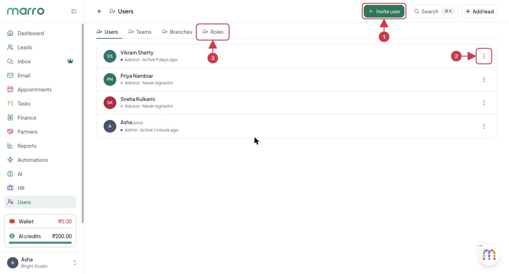

Open **Users** in the menu. The tabs are **Users**, **Teams**, **Branches** and **Roles**; this guide covers the **Users** tab.

## Invite someone

<Frame>
  
</Frame>

<Steps>
  <Step title="Invite user">Choose **Invite user** and enter their details.</Step>
  <Step title="Pick a role">The [role](/guides/roles) decides what they can see and do.</Step>
  <Step title="Send">Marro emails an invitation, or you can set a password yourself.</Step>
</Steps>

## Manage a person

| Action | How |
| --- | --- |
| Change their role | Their **⋯** menu |
| Switch them off | Their **⋯** menu |
| Put them in a team | See [Teams](/guides/teams) |

## Password links

| Topic | Rule |
| --- | --- |
| Invitation link | Sets a password only for an account your organization manages |
| Shared and platform accounts | Use **Forgot password** |
| A reset | Signs everyone out |

## Ask Marro

<Card title="Try asking" icon="message-circle">
  *"Invite priya@example.com as an Advisor"*

  Marro shows the invitation and asks before sending.
</Card>
