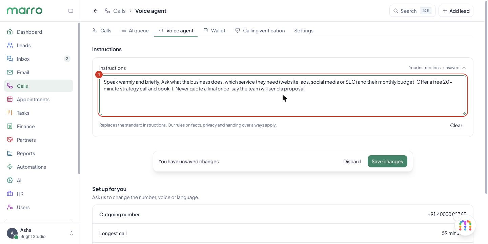

The voice agent is the AI that makes and answers your AI calls. Open **Calls → Voice agent** to see it, and write its instructions under **Voice agent** in [your AI team](/guides/agents#give-them-instructions).

## Its instructions

<Frame>
  
</Frame>

| It does this | How |
| --- | --- |
| Answers questions | From your public business knowledge and your active product catalogue. If it cannot confirm a price or detail, it says so and offers a team follow-up. |
| Speaks the right language | Starts in the lead’s saved language, or your business default. Callers can ask to switch during a call. |
| Books appointments | Confirms once booking succeeds. |
| Handles silence | After about 15 seconds without an answer it checks in once, then says goodbye after 12 more seconds. |

## Set up for you

<Steps>
  <Step title="Add your business knowledge">AI calls stay off until it is added.</Step>
  <Step title="Marro's team sets the voice and language with you">Nothing for you to configure.</Step>
  <Step title="Check Calls → Voice agent">It shows whether the agent is active, your outgoing number, the longest a call can last, and how many calls can run at once (up to 100).</Step>
</Steps>

## Request more lines

**Calls at once** is how many AI calls can run together.

<Steps>
  <Step title="Request">Choose **Request more lines** and enter the total you need (up to 100).</Step>
  <Step title="Wait for review">The row shows **Withdraw** while Marro’s team reviews it. One request at a time.</Step>
  <Step title="Get the answer">You and your administrators get an email either way.</Step>
</Steps>

New calls go out from the active number that has made the fewest calls today, and each number has a daily limit. Every number rings back to your voice agent.

## Ask Marro

<Card title="Try asking" icon="message-circle">
  *"How many AI calls can run at once? Ask for 10 lines."*

  Marro tells you your lines and prepares the request for you to approve.
</Card>
