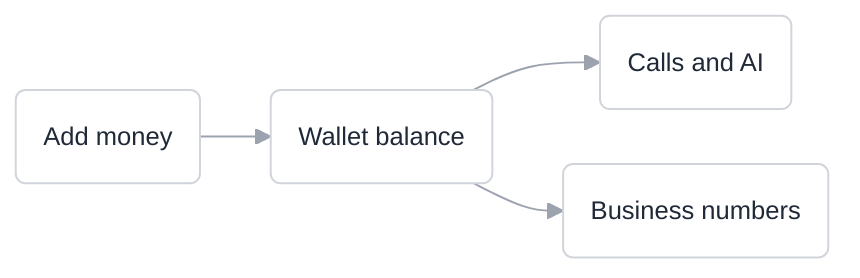

The wallet is a prepaid balance in rupees, in **Settings → Plan and modules → Wallet**. It never expires, and when it is empty AI pauses, so you never owe money for AI. Your subscription isn't paid from it.

## What it pays for

| Paid from the wallet | Notes |
| --- | --- |
| AI calls | Minutes used. See [AI calling](/guides/ai-calling#paying-for-calls) |
| Cloud calls | See [Charges and the wallet](/guides/cloud-calls#charges-and-the-wallet) |
| AI beyond your plan's credits | See [AI usage and credits](/guides/ai-usage) |
| Business numbers | A monthly price per number, the same on every plan, taken a month in advance and shown as **Business number** |

Meta bills WhatsApp messages to your own Meta account.

## Add money

<Steps>
  <Step title="Open the wallet">**Settings → Plan and modules → Wallet**. At the foot of the left menu, a bar shows the balance and turns red when it is low. Press it to open the wallet.</Step>
  <Step title="Add money">Choose **Add money**, then a preset amount or your own, from ₹100 to ₹1,00,000.</Step>
  <Step title="Pay">Pay by card, UPI or net banking. The money is added once the payment is confirmed.</Step>
</Steps>

Only administrators can add money.

## Held money and charges

| You see | Meaning |
| --- | --- |
| **Available** | What you can spend now |
| **Held for calls in progress** | Cloud calls set aside 10 minutes at a time, check the final charge at hang-up and return the unused amount |
| **This month** | Charges so far, and the full history below with **Show earlier** |

If the wallet is short for a business number, the page says the number is unpaid. Add money and the month is paid straight away. A number unpaid for 7 days may be released by Marro's team, never automatically.

## Ask Marro

<Card title="Try asking" icon="message-circle">
  *"Where do I add money to the wallet?"*

  Marro points you to the Wallet page. Paying money in stays with you, in checkout: Marro never does it.
</Card>
