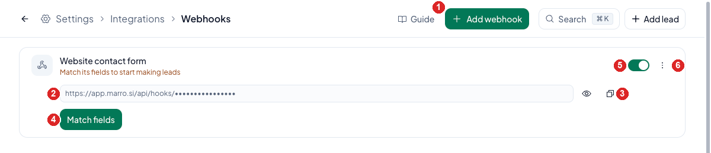
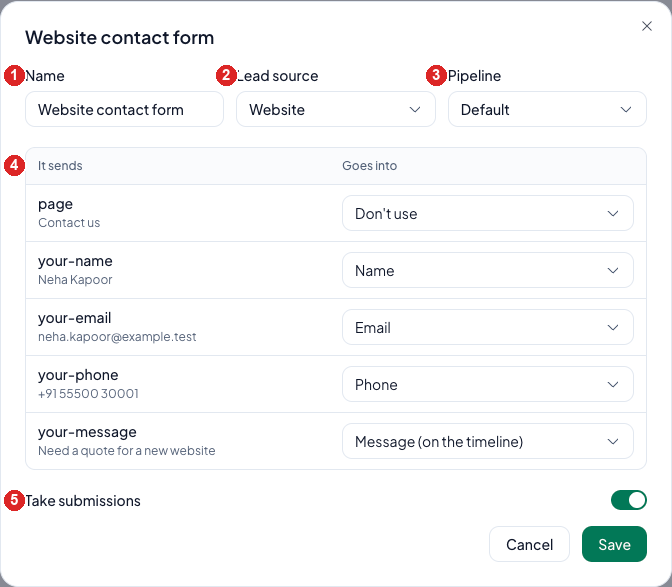

import { Flow } from "/snippets/flow.jsx";

Form tools such as Elementor, Typeform, JotForm, Google Ads lead forms and landing page builders can send each submission to a web address. Give each one its own Marro address and its submissions become leads, with no code. Open **Settings → Integrations → Webhooks**.

## Set one up

<Steps>
  <Step title="Add a webhook">Choose **Add webhook** and name it after the form, for example "Website contact form".</Step>
  <Step title="Paste the address">Copy it into your tool's webhook URL box. It accepts JSON, form posts and query strings.</Step>
  <Step title="Send a test">Submit your form once. Marro shows what arrived and suggests where each field goes.</Step>
  <Step title="Match fields">Choose **Match fields** and pick the Marro field each one fills: name, phone, email, a message for the timeline, or any lead field. Name and phone are needed.</Step>
  <Step title="Save">Choose the lead source and pipeline, then save.</Step>
</Steps>

<Frame>
  
</Frame>

1. **Add webhook**.
2. Its address, to paste into your form tool.
3. Copy the address. The eye shows it in full.
4. **Match fields**, once a test has arrived.
5. On or off: off stops taking submissions.
6. **Replace address** or **Delete**.

<Frame>
  
</Frame>

1. The webhook's name.
2. **Lead source**: where the leads say they came from.
3. **Pipeline** they go into.
4. Each field your form sent, with what it held in the test, and where it goes. Marro suggests these; change any. **Don't use** leaves one out.
5. **Take submissions**.

Submissions that arrive before the fields are matched are kept for the test, but don't become leads.

## What happens next

<Flow steps={["Form submitted", "Marro webhook", "Lead made or updated", "Owner assigned", "Automations run"]} />

Someone you already have, by phone or email, is updated instead of added twice: only empty fields are filled. The submission shows on the lead's timeline.

## Manage it

| Control | What it does |
| --- | --- |
| Counts and last problem | Shows submissions, leads and why one failed |
| **Replace address** | Gives a new address. The old one stops at once |
| **Take submissions** | Turn off to pause |

## Check it came from Marro

Each event Marro sends to your address is a `POST` with a JSON body of `id`, `event`, `occurredAt`, `test` (on test events only), `organization`, `lead` and `change`. These headers come with it.

| Header | What it holds |
| --- | --- |
| `X-CRM-Signature` | `sha256=` followed by the hex HMAC-SHA256 of the raw body, keyed with the **Signing secret** shown on the page |
| `X-CRM-Event` | The name of the event |
| `X-CRM-Delivery` | Identifies the delivery. Every try of one event has the same value, so your workflow can ignore one it has already had |

```text
X-CRM-Signature: sha256=<hex HMAC-SHA256 of the raw body, keyed with the Signing secret>
```

An event that gets no answer, a `429` or a `5xx` is tried again after 1 minute, 5 minutes, 30 minutes, 2 hours and 8 hours, then dropped.

## For developers

<Card title="Writing your own website code?" icon="code" href="/guides/connect-a-website">
  Use the lead capture API, which takes the same fields from your server.
</Card>
