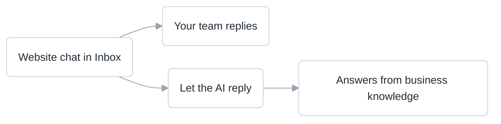

import { Flow } from "/snippets/flow.jsx";

Website chat adds a chat bubble to your website. Chats arrive in the [Inbox](/guides/inbox), where your team or the conversation agent replies. It is part of the Inbox module, and you need permission to manage settings.

<Flow steps={["Visitor chats", "Leaves phone number", "Lead, source Website chat", "Inbox reply"]} />

A visitor who gives a number joins the lead who already has it. New leads have no owner until someone assigns them.

## Set it up

Open **Settings → Messaging → Website chat**.

| Setting | What it does |
| --- | --- |
| **Show the chat on your website** | Off hides the bubble. Chats already in the Inbox stay |
| **Chatbot name**, **Bubble text** | Both can be left empty |
| **Greeting** | The first message visitors see |
| **Ask for a name and phone number first** | On by default |
| **Colour** | **Your branding colour** or **Another colour** |
| **Corner** | **Bottom right** or **Bottom left** |
| **Websites it may be on** | One per line, with subdomains |

Save to create the chat and see its code.

## Add it to your website

<Steps>
  <Step title="Copy the code">
    Under **Add it to your website**, press **Copy code**.
  </Step>
  <Step title="Paste it">
    Put it just before `</body>` on each page, or in your site builder's custom code.
  </Step>
</Steps>

The code never changes. Later setting changes reach your site within five minutes.

## What visitors see

| They see | Detail |
| --- | --- |
| A round button | In your corner, unread replies counted on it |
| A full-screen chat | On a phone |
| "Powered by Marro" | Under the message box |
| Their earlier chat | When they return on the same browser |

Messages are text only, up to 2,000 characters.

## Reply

Reply beside WhatsApp and other chats, or choose **Let the AI reply**: the [conversation agent](/guides/agents) answers from your [business knowledge](/guides/business-knowledge).
