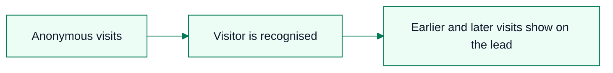

Website tracking records the pages people visit on your own website. Once a visitor becomes a lead, their visits show on the lead, before and after they got in touch.

<Note>
  Part of the Leads module. You need permission to manage your organization's settings to set it up.
</Note>

## Set it up

<Steps>
  <Step title="Open Website tracking">
    **Settings → Integrations → Website tracking**.
  </Step>
  <Step title="Add your websites">
    Under **Your websites**, one per line, like `example.com`. Subdomains are included. Other sites are ignored.
  </Step>
  <Step title="Turn it on">
    Turn on **Record visits** and press **Set up website tracking**.
  </Step>
  <Step title="Add the code">
    Press **Copy code** and paste it just before `</body>` on every page, or in your site builder's custom code.
  </Step>
  <Step title="Update your privacy policy">
    Press **Copy text** under **Your privacy policy** and add it to your website's policy.
  </Step>
</Steps>

The code never changes, so later settings need no website edit. The page shows visits from the last 30 days, so you can see it working.

## How visitors become leads

| Way they are recognised | How |
| --- | --- |
| **Forms** | A Marro form on a tracked page links the visitor when sent |
| **Website chat** | A [website chat](/guides/website-chat) links them when they give their phone number |
| **Links you send** | With **Recognise leads from your links** on, links in emails and WhatsApp messages from Marro say which lead opened them |

## On the lead

| Where | Shows |
| --- | --- |
| **Website** in **About** | When they were last on your site ("2 hr ago") and the page they return to most ("Pricing 5×") |
| **Website visits** section | Pages viewed more than once, then each recent visit: where from ("Google search", "Facebook ad", "Direct visit"), device, time on site and pages in order. Opens by itself after a visit in the last 7 days |
| **Timeline** | One **Website visit** entry per visit, at its own time |

Pages show by name ("Pricing"). The mobile app shows the same.

## Automations

Choose the trigger **A lead visits a page on your website** in an [automation](/guides/automations).

| Option | Effect |
| --- | --- |
| **Address contains** / **Address is** | A text like `pricing`, or a page like `/pricing`. Empty means any page |
| **Once per page per visit** | On by default: reopening a page in one visit starts nothing |

Only known leads start it. A follow-up for the lead's owner needs the lead to have an owner.

## Reports

In [custom reports](/guides/custom-reports) choose the source **Website visits**: count visits by date, source, campaign, landing page, device and known lead, with pages viewed and time on site. People who see only some leads see only those leads' visits.

## Privacy

| Setting | Effect |
| --- | --- |
| **Ask before recording** | EU, UK and Switzerland visitors are always asked first. **Everyone** asks every visitor |
| **Show the cookie notice** | Small notice with **Accept** and **Decline**. With your own consent tool, turn it off and call `marro("consent", true)` on agreement |
| **Keep visits for** | 13 months by default (1 to 24). Older visits are removed daily |

Also: Do Not Track, Global Privacy Control and bots are never recorded. Network addresses are shortened, and emails or tokens in page addresses are removed. Deleting a lead removes its visits for good.

## Ask Marro

<Card title="Try asking" icon="message-circle">
  *"What did Priya look at on our website?"*

  Marro answers from the lead's visits, and can change these settings after you approve.
</Card>
