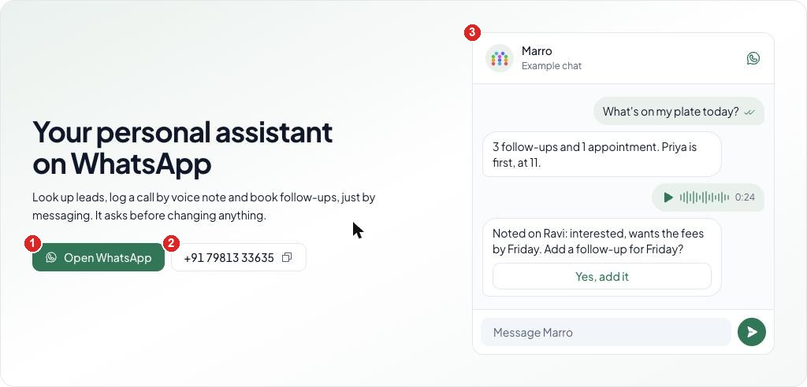
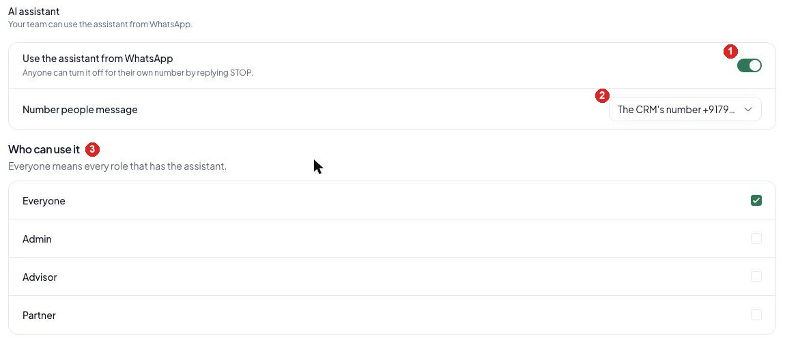

Your team can use the assistant from WhatsApp, with the same access as on the web. Open the menu under your name (bottom left), then **Your personal assistant on WhatsApp**.

<Frame>
  
</Frame>

1. **Open WhatsApp** starts a chat with Marro's number.
2. The number, to copy or save as a contact.
3. An example of what a chat looks like.

Marro knows you by the phone number on your account. Message from that number.

## What you can do in the chat

| You | Marro |
| --- | --- |
| Ask a question | Answers from your leads, follow-ups and reports |
| Ask for a change | Sends **Approve** and **Cancel** buttons. "yes" or "no" works too |
| Send a voice note | Understands it, and replies with a voice note |
| Send a photo or PDF | Reads it for that reply |
| Send `help` | Shows what it can do |
| Send `stop` or `start` | Turns it off or on for your number |

It only talks about your work in Marro. Chats are saved like any assistant chat.

## If something is off

| The page says | What to do |
| --- | --- |
| **Your account has no phone number** | Add your WhatsApp number to your user in **Users** (or ask an admin) |
| **Your number is on more than one account** | Nothing. Marro asks which account to use; send `switch account` to change |
| **Turned off for you** | Turn the switch on, or send `start` |
| You belong to several organizations | Marro asks which. Send `switch organization` to change |

## For administrators

<Frame>
  
</Frame>

Open **AI → Settings**, under **AI assistant**:

1. **Use the assistant from WhatsApp** turns it on or off for your organization.
2. **Number people message**: **The CRM's number**, or **Your WhatsApp Business** number once it is connected in **Inbox → Settings → WhatsApp number**.
3. **Who can use it**: **Everyone** with the assistant, or only the roles you tick.

Then **Save changes**.

## Try asking

<Card title="Try asking on WhatsApp" icon="message-circle">
  *"What's on my plate today?"*

  A voice note: *"Spoke to Ravi, he wants the fees by Friday."*

  *"Book a follow-up with Ravi on Friday at 11."*
</Card>
