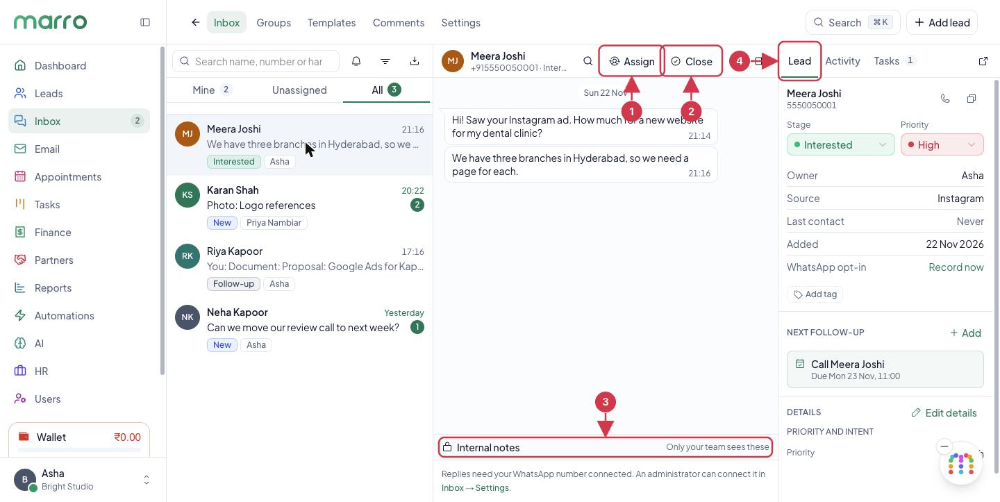

A WhatsApp chat belongs to a lead, so a WhatsApp **contact** is a lead. Tags, details, lists and imports work the same in the Inbox as for leads.

## Tags on chats

<Frame>
  
</Frame>

<Steps>
  <Step title="Tag a chat">Open a chat. In the **Lead** panel beside it, choose **Add tag** (or **Edit tags**).</Step>
  <Step title="Find chats by tag">Open **Filters** above the chat list, choose **Tag** and pick one. **Clear** removes it.</Step>
</Steps>

Anyone who can edit leads can tag. Rename, recolour or delete tags in **Settings → Leads → Tags**. A chat with no lead yet (for example from Instagram) has no tags until you add it as a lead.

## Attributes

| Where | What you do |
| --- | --- |
| **Details** in the Lead panel | Shows every field your organization keeps. **Edit** changes them |
| **Settings → Leads → Fields** | Add fields ([custom fields](/guides/custom-fields)) |
| **Contact attributes** in a broadcast | Each person gets their own value. If it is empty, **If empty, send** goes out instead, or a dash |

## Segments and opt-in

| | What it is |
| --- | --- |
| Segment | A lead list from your filters, for example tag *Scholarship* and city *Pune*. It stays up to date. See [filtering](/guides/filtering) and [broadcasts](/guides/inbox#broadcasts) |
| **WhatsApp opt-in** | The date the person agreed to messages, or **Record now** if you know they did. The first record stays |

Opt-in is a record for you; it does not stop a broadcast by itself. People who reply STOP are still left out.

## Import contacts

<Steps>
  <Step title="Choose the file">Open **Leads → Import** and pick your CSV.</Step>
  <Step title="Match columns">Match each column to a lead field. For WhatsApp, use **WhatsApp opt-in** (`yes` records now, a date records that day, `no` or empty records nothing) and **Tags** (names separated by commas; new ones are created; up to ten per row, twenty per lead).</Step>
  <Step title="Choose for duplicates">Numbers you already have are **updated** or **skipped**. Tags and opt-in apply to existing leads only when you update.</Step>
</Steps>

## Download chats

People with the **Export leads** permission see a download button beside the Inbox filters.

| Choose | Options |
| --- | --- |
| Chats | Open or closed, a tag, a number, a date range |
| Detail | One row per chat, or **Include every message** for one per message |

- You get name, number, status, owner, tags, opt-in, last message and message count. Media is shown only by kind, such as `[image]`.
- You download only chats you can see. Every download is recorded in **Settings → Audit log**.
- The limit is 20,000 chats or 50,000 messages; narrow the dates if you hit it.

## Ask Marro

<Card title="Try asking" icon="message-circle">
  *"List chats tagged Scholarship"*

  *"Tag Neha as Hot"*

  Marro asks you to confirm changes. It cannot download a file.
</Card>
