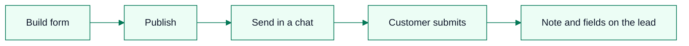

A **form** (Meta calls it a *Flow*) opens inside WhatsApp, so a customer fills it in without leaving the chat. The answers come back to Marro as a note on their lead and, if you choose, as lead fields.

<Note>
  Forms need a connected WhatsApp Business number. Meta requires a verified business to publish and send forms, and may refuse one it finds a problem with. Marro shows Meta's messages.
</Note>

## Build a form

<Steps>
  <Step title="Start">
    Open **Inbox → Settings → Forms**, choose **New form**, and pick Contact request, Appointment request, Feedback or blank.
  </Step>
  <Step title="Shape it">
    Name it (only your team sees the name), then write the heading and an optional introduction. A phone beside the builder shows what the customer sees.
  </Step>
  <Step title="Add questions">
    **Add a question** (up to 20). Drag to reorder. Open one to set its words, options, whether it is required, and **Save on the lead as** to fill a lead field.
  </Step>
  <Step title="Publish">
    **Save draft** keeps your work. **Publish** checks the form with WhatsApp; if there is a problem it stays a draft and says why.
  </Step>
</Steps>

| Question types |
| --- |
| Short answer, long answer, email, phone, number, drop-down, pick one, pick several, date, tick box, plus a heading or a note |

A published form can't be changed: **Make a copy**, change the copy and publish it. **Retire** stops a form being sent.

## Send a form

<Steps>
  <Step title="Open a chat">
    Choose **Send a form** (the clipboard icon beside the message box).
  </Step>
  <Step title="Pick and send">
    Pick the form, check the message and button label, and send. The assistant can send one too, after you approve the message.
  </Step>
</Steps>

Like other free messages, it can only go while the chat's 24-hour window is open and never after the customer replied STOP.

## What comes back

| Result | Where |
| --- | --- |
| A note, "Completed the form …" | The lead's timeline |
| Mapped answers | The lead's fields. A value a field does not accept is left out; the note still shows it. |

Sending the same answer twice changes nothing.

## Not available yet

| Feature |
| --- |
| Forms with several screens |
| Data that changes while the customer fills it in |
| Forms inside message templates |
