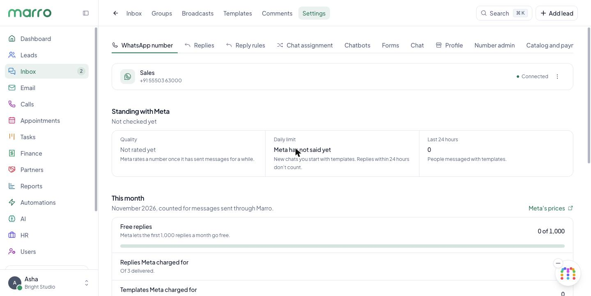

**Inbox → Settings → WhatsApp number** is where your team's WhatsApp number is connected to Marro. Your team then answers every chat in the [Inbox](/guides/inbox), on the web or in the app.

Open **Settings** in the Inbox's left menu. It lists four groups with their pages; choose a page:

| Group | Pages |
| --- | --- |
| **Number** | **WhatsApp number**, **Profile**, **Number admin**, **Blocked** |
| **Automation** | **Replies**, **Reply rules**, **Chatbots**, **Forms** |
| **Team & chat** | **Chat assignment**, **Chat**, **Website chat** |
| **Commerce** | **Catalog and payments** |

The **Guide** link for the page you are on is at the top right, next to **Search**.

The left menu also holds **Inbox**, **Comments**, **Broadcasts**, **Templates** and **Groups**, and shows only what your role can open. Use **Collapse** at its foot to fold it to a strip of icons (on the Inbox itself it starts folded, to keep the chat wide); Marro remembers your choice. On a phone, the **Menu** button at the top of the Inbox opens it.

## Connect your number

<Frame>
  
</Frame>

<Steps>
  <Step title="Open the page">Go to **Inbox → Settings → WhatsApp number** and look at **Connect your number**.</Step>
  <Step title="Choose your number">**My WhatsApp Business app number** keeps the app working on your phone, and the last six months of chats come across. **A number not on WhatsApp yet** is confirmed by Meta with a code by SMS or call.</Step>
  <Step title="Continue with Meta">Sign in with Facebook and choose your portfolio, account and number. The page then shows **Connected**.</Step>
</Steps>

Earlier chats with people who are already leads come in as read. If you have your own Meta app, connect it in **Settings → Integrations → WhatsApp Business (Meta)**.

## Standing with Meta and this month

| Card | What it shows |
| --- | --- |
| **Number summary** | Under the number's name and **Connected** status: **Quality**, the **Daily limit** (new chats you start with templates; replies within 24 hours do not count), **Last 24 hours** used, when Meta was last checked, a **WhatsApp Manager** link and **Alerts this week** |
| **This month** | **Free replies** used (Meta lets the first 1,000 a month per number go free), **Replies charged** and **Templates charged** |
| **Alerts and billing** | **Send staff alerts from this number**, and **Paid to Meta**: Meta bills your Meta business account, Marro adds no per-message charge |

## Staff alerts, rename and disconnect

| Setting | What it does |
| --- | --- |
| **Send staff alerts from this number** | Assignments and reminders to your team come from this number instead of Marro's. Meta charges for each |
| **Rename number** | What your team calls it, such as Sales or Support. Customers do not see it |
| **Disconnect** | Marro stops sending and receiving on it. Broadcasts, automations, reminders and staff alerts on it stop. Nothing is deleted and you can connect it again |

## Ask Marro

<Card title="Try asking" icon="message-circle">
  *"Is our WhatsApp number connected?"*

  *"How many free replies have we used this month?"*

  Marro reads the number's standing. Connecting and disconnecting are done on the web.
</Card>
