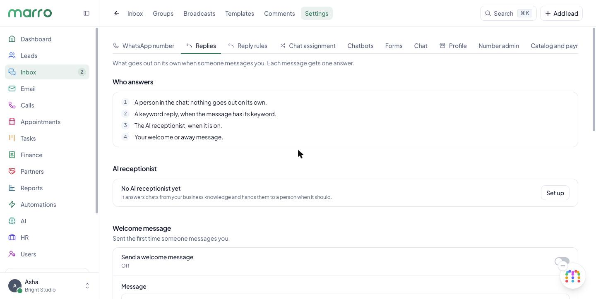

**Inbox → Settings → Replies** and **Reply rules** decide what goes out on its own when someone messages you. Each message gets one answer, and a person in the chat is never talked over.

## Who answers

<Frame>
  
</Frame>

## The cards

| Card | What it does |
| --- | --- |
| **AI receptionist** | **On** or **Off**, with **Manage** or **Set up**. Answers from your [business knowledge](/guides/business-knowledge) and hands over to a person when it should |
| **Welcome message** | First time someone writes. `{{first_name}}` fills their name |
| **Away message** | Outside your working hours (from **Settings → HR**), once per closure |
| **Keyword replies** | Keywords separated by commas, and a message or an approved template |

## Keyword replies and the default reply

<Steps>
  <Step title="Add a rule">In **Reply rules**, choose **Add rule** and name it.</Step>
  <Step title="Choose how it matches">**Contains the words**, **Is exactly**, **Starts with** or **Contains the text**, then the keywords.</Step>
  <Step title="Choose the reply">**A message** (inside the 24-hour window) or **An approved template** (can go when the window is closed).</Step>
  <Step title="Order the rules">Drag to change the order. The first match from the top answers, once per chat every 10 minutes.</Step>
</Steps>

A **Default reply** goes out when nothing else answered. Quick replies, ice breakers (up to 4) and commands (up to 30) are set on the same pages.

## Ask Marro

<Card title="Try asking" icon="message-circle">
  *"Add a keyword reply for fees"*

  *"Turn the away message off"*

  Marro asks your approval before any change, and always before deleting a quick reply.
</Card>
