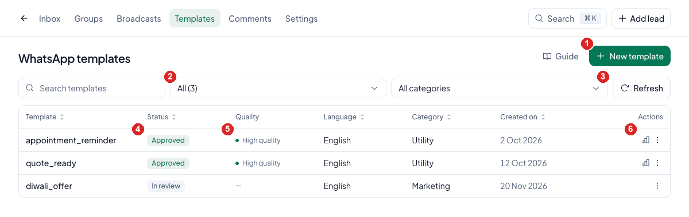
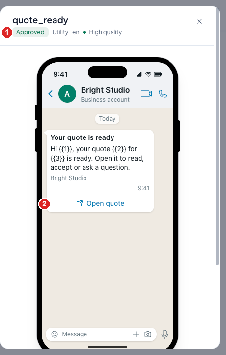

**Inbox → Templates** lists the message templates you send when a chat is outside its 24-hour window, and in [broadcasts](/guides/inbox#broadcasts). Meta approves each one.

## Your templates

<Frame>
  
</Frame>

1. **New template**.
2. Show one status, such as **In review**.
3. **Refresh** reads the latest from Meta.
4. **Approved**, **In review** or **Rejected**: Meta's decision.
5. Meta's quality rating.
6. How it did: sent, delivered, read and taps for 30 days. The menu beside it has **Delete**.

Click a template to see it as the customer will.

<Frame>
  
</Frame>

1. Its status, category, language and quality.
2. Its buttons, as the customer sees them.

| Column | Meaning |
| --- | --- |
| Name, language, category | Marketing or Utility |
| Status and quality | Meta's decision and rating |
| Chart icon | Sent, delivered, read and taps for 30 days |

**Refresh** reads the latest from Meta. **Delete** removes a template at Meta, and the name cannot be reused for 30 days.

## Write a new template

<Steps>
  <Step title="New template">Choose **Category** (Marketing or Utility), **Name** and **Language**, then **Next**.</Step>
  <Step title="Write it">Optional **Header** (text, picture, video or PDF sample up to 4 MB), the **Message** with placeholders like `{{first_name}}`, an optional **Footer** and **Buttons**.</Step>
  <Step title="Review">Choose **Review template** to check whether it reads as Utility or Marketing. Use fictional examples; AI review uses AI credits.</Step>
  <Step title="Submit">**Submit for review**. Meta decides, and reviews again after an edit.</Step>
</Steps>

## Special kinds

**Or write a special kind** adds more:

| Kind | Needs |
| --- | --- |
| One-time code | Button label, minutes valid. You enter the code when sending. Phone numbers only |
| Coupon code | A **Copy offer code** button |
| Limited-time offer | Heading up to 16 characters, optional countdown of 1 to 720 hours |
| Carousel | 2 to 10 cards, a file per card |
| Product, Several products | A catalog connected in Meta Commerce Manager |

## Ask Marro

<Card title="Try asking" icon="message-circle">
  *"Which templates are approved?"*

  *"How did the fee reminder template do this month?"*

  Marro reads status and results. Writing and submitting a template is done on the web.
</Card>
