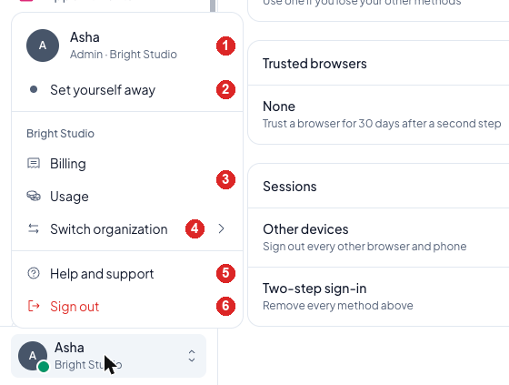
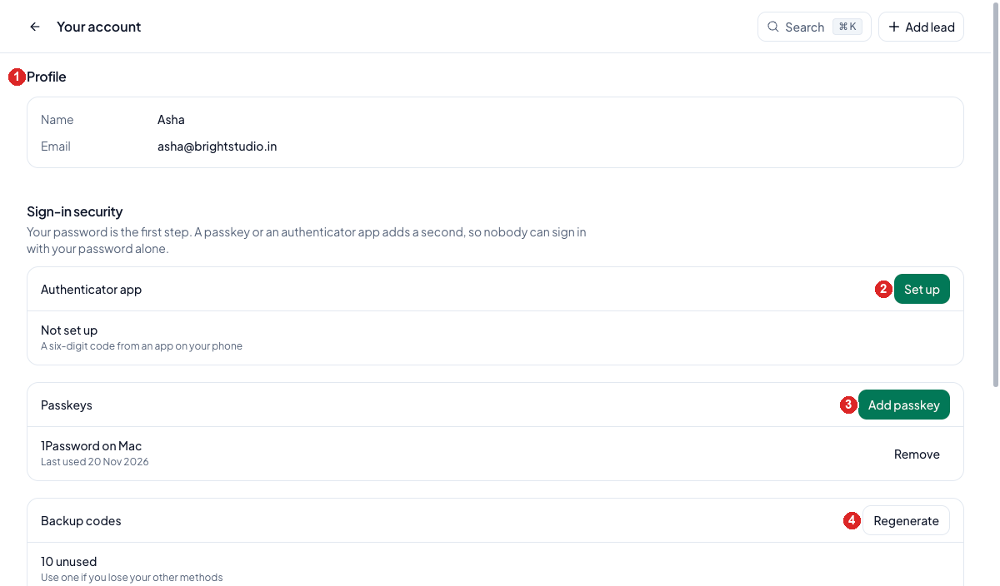
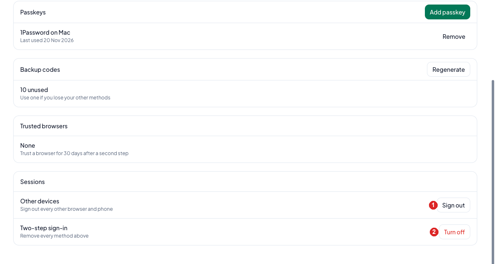

Click your name at the bottom left to open your menu.

<Frame>
  
</Frame>

1. Your name, role and organization. Click it to open **Your account**.
2. **Set yourself away** when you step out. Team rotations and calls skip you, and if your agents are on, they answer your WhatsApp chats. Set yourself available when you are back.
3. Your organization's own pages, such as **Billing** and **Usage**, for those allowed to see them.
4. **Switch organization**, if you belong to more than one.
5. **Help and support**.
6. **Sign out**.

If the WhatsApp assistant is on for you, the menu also has **Your personal assistant on WhatsApp** (see [WhatsApp assistant](/guides/whatsapp-assistant)).

## Your account

<Frame>
  
</Frame>

1. **Profile**: your name and email. An admin changes them in **Users**.
2. **Authenticator app**: **Set up** a six-digit code from an app on your phone.
3. **Passkeys**: **Add passkey** to use your fingerprint, face or PIN. **Remove** one you no longer use.
4. **Backup codes**: ten codes, each used once, for when you lose your phone. **Regenerate** makes a new set and cancels the old one.

<Warning>
Save your backup codes somewhere other than your phone. Without them, a lost phone means asking an admin to reset your sign-in.
</Warning>

Further down:

<Frame>
  
</Frame>

1. **Sign out** every other browser and phone, such as after using a shared computer.
2. **Turn off** two-step sign-in, removing every method above.

**Trusted browsers** lists the browsers that skip the second step for 30 days. How each method works is in [Two-step sign-in](/guides/two-step-sign-in).
